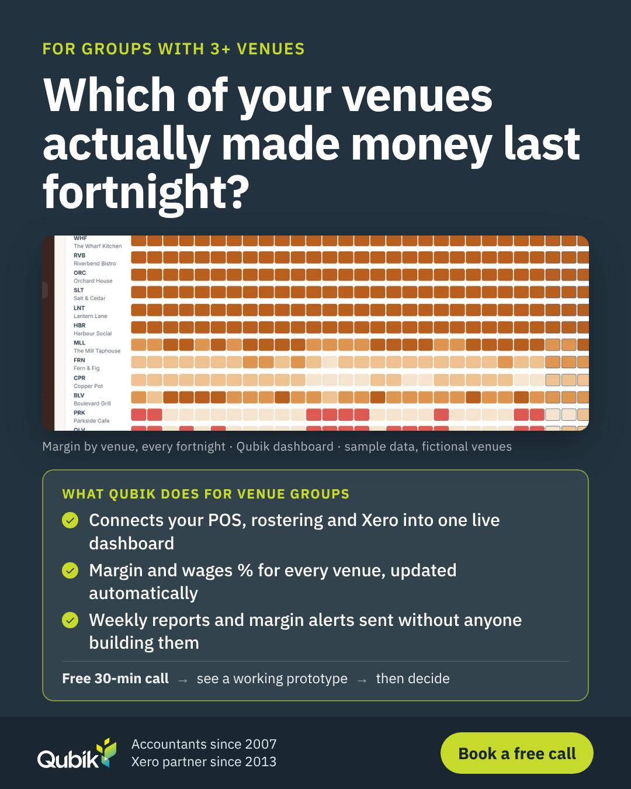
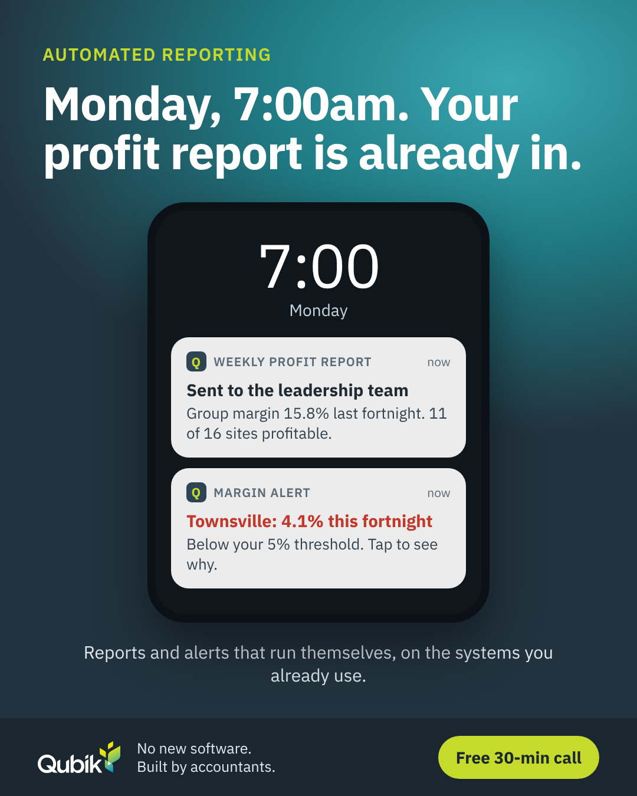
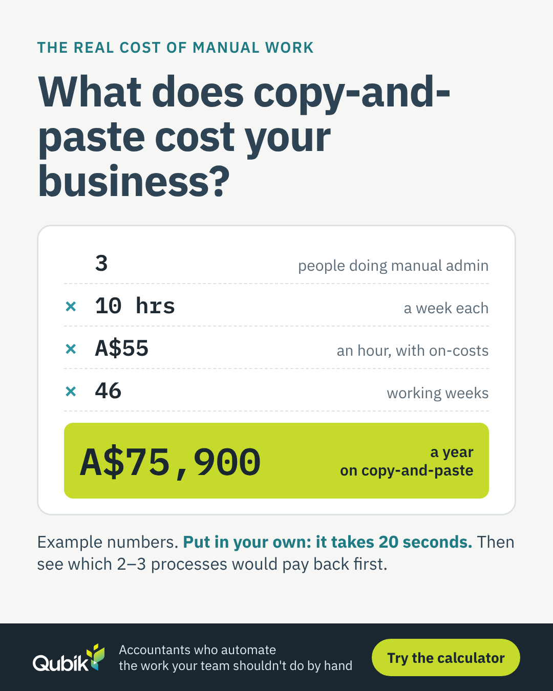
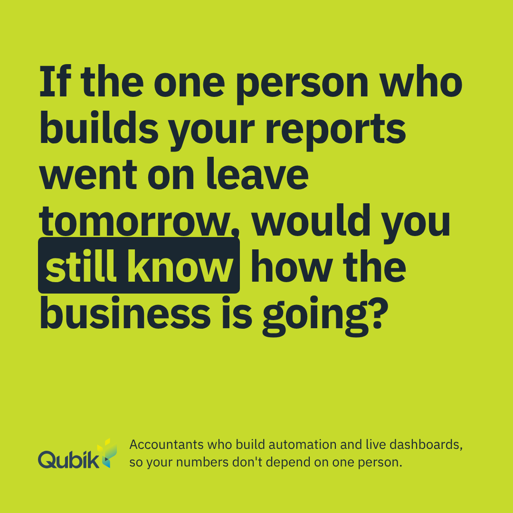
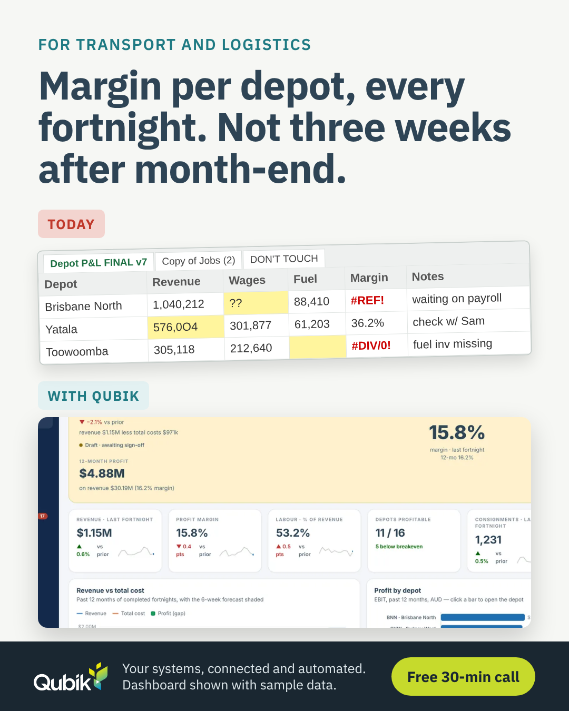
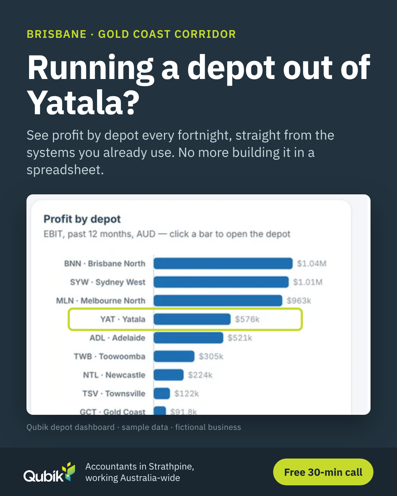
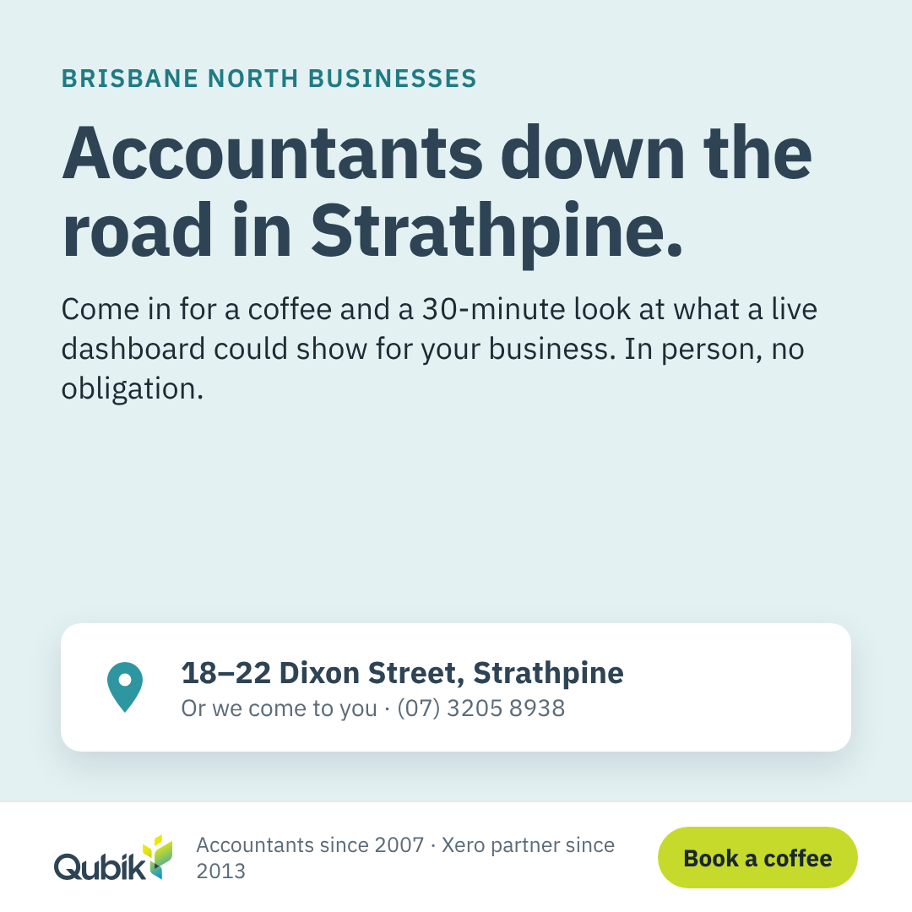
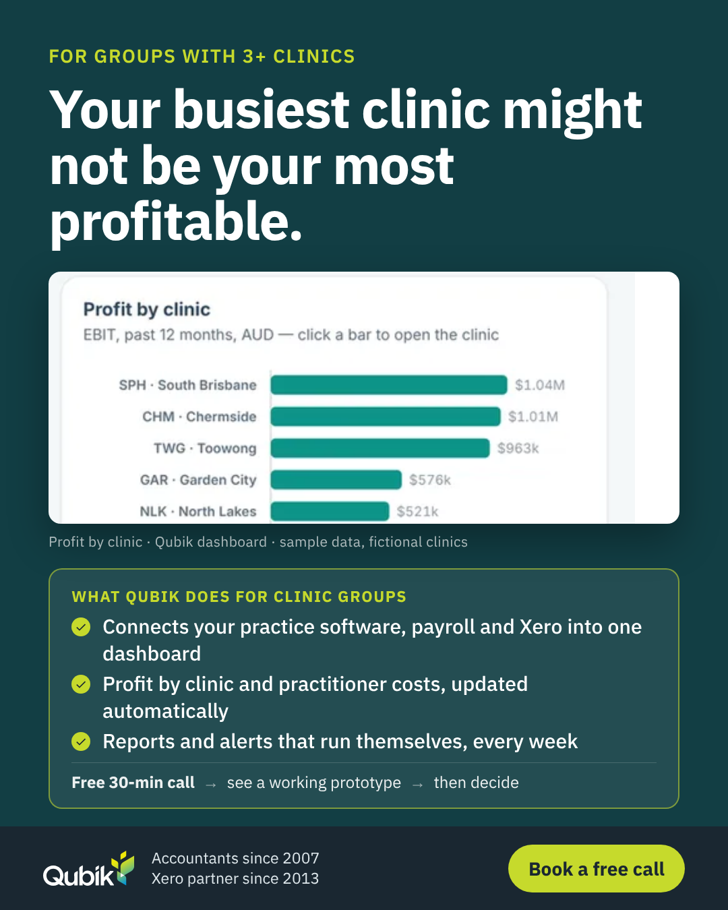
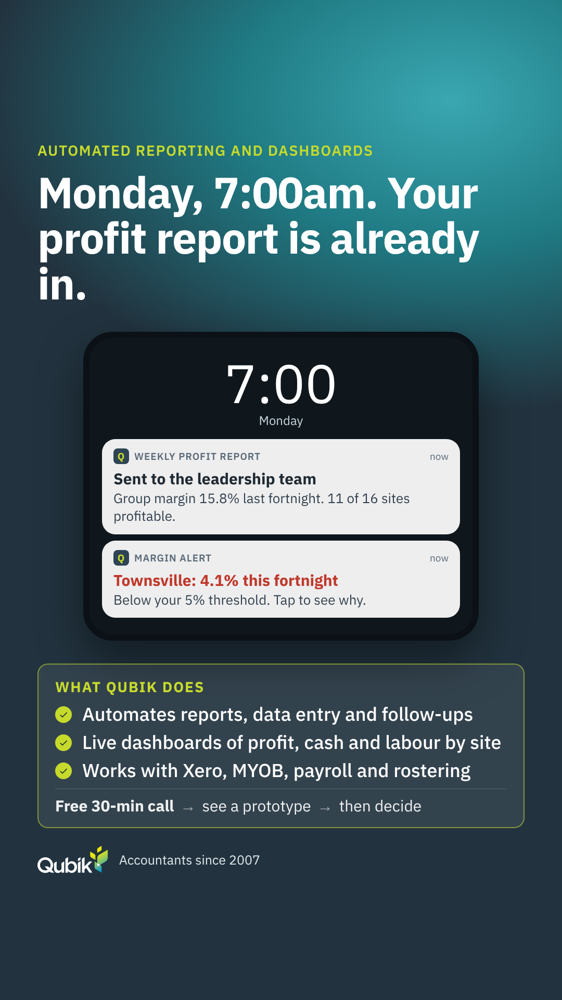

# Qubik: Meta (Facebook + Instagram) ads strategy

**Written:** 18 Nov 2026. **Status:** ready to build once the account and tracking are set up; nothing is live.
**Related:** `linkedin-meta-strategy.md` (base plan for both channels), `creative-campaign-playbook.md` (creative layer), sample creatives in `meta-ads/`.

All cost figures are estimates from public 2026 benchmarks, where Australian B2B data is thin. Replace them with our own numbers after four weeks. Items marked *verify* need checking in Ads Manager.

---

## 1. What Meta is for, in this plan

| | |
|---|---|
| **Who** | Owner-operators and GMs of Australian businesses with **10–100 staff**, especially **multi-site** ones: hospitality groups, clinic groups (allied health, dental, vet), early learning, transport and logistics, facilities services, trades. Most of them use Facebook and Instagram every day, which isn't true of LinkedIn. |
| **Job** | 1. Cheap leads for the free 30-minute call. 2. Cheap retargeting of everyone who visits qubik.com.au from any channel (Google, LinkedIn, Meta). |
| **Not for** | Large-company CFOs (LinkedIn does that better). |
| **The catch** | Meta's B2B targeting is loose: interests and job details are treated as suggestions. **So the ad has to do the targeting**: the first line and image name the business type ("Run 3+ venues?"), and the form filters out the rest. |

**Targets (first 8 weeks):** cost per lead A$50–150; at least 35% of leads qualified (10+ staff, a real problem); **cost per qualified lead ≤ A$300**; **cost per call held ≤ A$600**.

---

## 2. Account setup (before any spend)

1. **Meta Business Portfolio** owned by Qubik, with the Qubik Facebook Page and Instagram account added. Vinay is an admin; Dominic holds ownership.
2. **Ad account** in **AUD**, time zone Brisbane, Qubik's payment card.
3. **Dataset (Pixel)** "Qubik website", added to the landing page and thank-you page tracking blocks (section 8).
4. **Domain verification** for qubik.com.au using a **DNS TXT record** (the developer handling `send.qubik.com.au` can add it), because a WordPress Contributor can't edit the site's `<head>`.
5. **Special ad category:** none. The ads are about automation and reporting, not credit, insurance or financial products. If Meta flags one anyway, appeal first. If it's forced, targeting shrinks to location only, which the ads can cope with.
6. **Page polish:** profile photo (logo), cover image (a dashboard screen), "About" with the phone number, and 3–5 recent posts. People click through to the Page before filling in a form.

---

## 3. Campaign structure

| Campaign | Objective | Budget | Ad sets | Starts |
|---|---|---|---|---|
| **QBK_META_TEST** | Leads (Instant Form) | **A$25/day**, split evenly across ad sets (ad set budgets) | One ad set per *concept*, 2–3 ads each | Week 1 |
| **QBK_META_LOCAL** | Leads (Instant Form) | **A$15/day** | L1 industrial precincts · L3 Brisbane North | Week 1 |
| **QBK_META_RETARGET** | Leads (landing page) | **A$10/day** | Warm audiences (section 4) | Week 1 (it fills as traffic arrives) |
| **QBK_META_SCALE** | Leads (Instant Form or website, whichever wins) | From week 3–4: A$15–30/day, moved from the test budget | Winning ads, moved in **with the same post ID** to keep the likes and comments | Week 3–4 |
| **QBK_META_EVENT** | Leads | A$30–50/day on show days only | Venue pins (section 4) | From May 2027 |

**Settings on every campaign:**
- Placements: Advantage+ placements, **but exclude Audience Network** (poor-quality apps and sites for B2B).
- Optimisation: leads. Later, once there are 30+ qualified leads a month, switch to **conversion leads** (Meta optimises for leads we mark as qualified, sent back through Make.com).
- Schedule: always on, except QBK_META_LOCAL's "Sunday night" ads (Sat–Sun 6–10pm, which needs an ad-set lifetime budget).
- Ad names follow the convention: `META_STAGE_AUDIENCE_CONCEPT_FORMAT_HOOK_v#` (for example `META_COLD_ADV_A4-hosp_IMG-heatmap_H3_v1`). The same text goes into `utm_content`.

**Total:** about **A$50/day (~A$1,520/month)** in weeks 1–3, rising to **A$65–80/day** once scaling starts.

---

## 4. Targeting

### Cold (QBK_META_TEST)
- **Location:** Australia, "people living in or recently in this location".
- **Age:** 30–65. Gender: all.
- **Advantage+ audience, with these suggestions:**
  - business: small business owners, business page admins, "Owner (business)" or "Managing director" job titles where available *(verify which still exist)*;
  - software: Xero, MYOB, QuickBooks, Microsoft Excel, Power BI;
  - industries: hospitality industry, restaurant management, logistics, freight transport, physiotherapy, dentistry, veterinary medicine, child care, facility management.
- **Exclusions:** current customers list (if used) and people who already submitted a lead (the Lead event, 180 days).
- **Note:** Meta will go beyond the suggestions. That's fine. The first line of the ad ("For groups with 3+ venues") and the form's staff question filter out the wrong people.

### Location plays (QBK_META_LOCAL)
Pins with a radius of about 2–3 km (the minimum is about 1–1.6 km, *verify*), several pins per ad set so the audience isn't too small.

| Ad set | Pins | Ad |
|---|---|---|
| **L1 Brisbane industrial** | Yatala, Eagle Farm / Pinkenba, Larapinta / Heathwood, Wacol, Brendale | Ad 06 (Yatala), with matching versions for the other suburbs |
| **L1 Sydney industrial** (week 3+) | Wetherill Park, Eastern Creek, Moorebank, Smeaton Grange | Ad 06 with the Sydney suburb named |
| **L1 Melbourne industrial** (week 3+) | Dandenong South, Truganina, Laverton North, Derrimut | Same |
| **L3 Brisbane North neighbours** | 5–15 km around Strathpine, North Lakes, Chermside, Brisbane CBD, Fortitude Valley / Newstead | Ad 07 (coffee in Strathpine) |

Age 30–65. Industrial areas: weekdays only.

### Retargeting (QBK_META_RETARGET)
Custom audiences:
- **Website visitors, 180 days** (all of qubik.com.au, which also captures Google and LinkedIn visitors), excluding the thank-you page.
- **Landing page visitors, 30 days who didn't submit:** the hottest group, shown the ads first.
- **Video viewers** (50%+ of any Qubik video), 90 days.
- **Instant Form openers who didn't submit**, 90 days.
- **Facebook Page and Instagram engagers**, 180 days.

Ads: Ad 02 / 09 (Monday 7am), Ad 03 (calculator), testimonial and "see a prototype before you commit" messages.

### Lookalikes (later, once there are 100+ leads)
1% Australia lookalike of **qualified** leads, and 1% of Qubik's accounting clients (only if marketing consent checks out). Test them as separate ad sets in QBK_META_TEST.

---

## 5. The sample ads

All images are in `paid-social/meta-ads/`. The HTML source is `meta-ads/src/creatives.html`; re-render with `node paid-social/meta-ads/src/render.js`. Dashboard screens show **sample data with fictional names**, and each ad says so.

Each ad lists its primary text, headline, description, CTA button and destination. The first ~125 characters of the primary text show before "See more", so the hook goes there.

### Ad 01: "Which of your venues made money?" (hospitality, concept A4)

- **Campaign:** QBK_META_TEST → ad set "A4 Hospitality". 4:5 feed image.
- **Primary text:**
  > Run 3+ venues? Quick question: which one made money last fortnight, after wages?
  >
  > Most groups we speak to find out weeks later, from a spreadsheet someone builds by hand. We connect your POS, rostering and Xero into one live dashboard: margin and labour by venue, every fortnight, with an alert when one slips.
  >
  > No new software. Built by accountants. You see a working prototype before you commit.
  >
  > Book a free 30-minute call 👇
- **Headline:** Profit by venue, every fortnight
- **Description:** Free call · no obligation
- **CTA:** Sign up → Instant Form
- **Variant hooks to test:** "Wages crept to 38% at one venue. When did you find out?" · "Your group total looks fine. Does every venue?"

### Ad 02: "Monday, 7:00am" (automated reporting, concept A9)

- **Campaign:** QBK_META_TEST (ad set "A9 Outcome") and QBK_META_RETARGET. 4:5 feed; **Ad 09** is the 9:16 Stories/Reels version of the same ad.
- **Primary text:**
  > Imagine Monday at 7am: your profit report is already in the leadership team's inbox, and you get an alert if any site has slipped below target.
  >
  > Nobody stayed late to build it. We automate the reports, alerts and data entry that eat your team's week, on the systems you already use: Xero, MYOB, payroll, rostering, spreadsheets.
  >
  > Free 30-minute call with business experts (we're accountants), not salespeople.
- **Headline:** Reports that run themselves
- **Description:** Accountants · Xero partner since 2013
- **CTA:** Learn more → Instant Form (cold) / landing page (retargeting)

### Ad 03: "What does copy-and-paste cost?" (calculator, concept A5)

- **Campaign:** QBK_META_TEST → ad set "A5 Calculator". From week 4, the landing page version of the test sends it to the calculator page.
- **Primary text:**
  > 3 people × 10 hours a week × A$55 an hour = about A$75,900 a year spent copying numbers between systems.
  >
  > That's an example. Put in your own numbers; it takes 20 seconds. If it's worth fixing, we'll show you which two or three processes would pay back first: supplier bills, orders, the month-end reporting pack.
- **Headline:** Work out your number in 20 seconds
- **Description:** Free calculator · no sign-up to see it
- **CTA:** Learn more → landing page (calculator section for now: `https://qubik.com.au/marketing/automation/#calc-h` (the calculator heading); the dedicated page P2 later)

### Ad 04: "If the one person who builds your reports went on leave…" (key-person risk, concept A1)

- **Campaign:** QBK_META_TEST → ad set "A1 Key person". 1:1 image, text-only style (looks like a post, not an ad).
- **Primary text:**
  > In most growing businesses, the numbers live in one spreadsheet, in one person's head. When they're away, the reporting stops. When they leave, it walks out the door with them.
  >
  > We're accountants who build automation and live dashboards, so your reporting runs itself and anyone can see how the business is going.
  >
  > If that sounds familiar, book a free 30-minute call. We'll tell you honestly whether it's worth fixing.
- **Headline:** Don't let your numbers depend on one person
- **Description:** Free call · no obligation
- **CTA:** Sign up → Instant Form

### Ad 05: "Spreadsheet vs dashboard" (logistics, concepts A4/A8)

- **Campaign:** QBK_META_TEST → ad set "A4 Logistics".
- **Primary text:**
  > Running depots? If your depot P&L lives in a file called "FINAL v7" with a tab nobody's allowed to touch, you're not alone.
  >
  > We connect your accounting, payroll and job systems into one dashboard: revenue, labour and margin by depot, every fortnight, checked against the accounts. Your team keeps working the way it does now.
  >
  > Free 30-minute call. See a working prototype before you commit to anything.
- **Headline:** Margin per depot, every fortnight
- **Description:** Built by accountants
- **CTA:** Sign up → Instant Form

### Ad 06: "Running a depot out of Yatala?" (location play L1)

- **Campaign:** QBK_META_LOCAL → ad set "L1 Brisbane industrial". Make one copy per precinct, changing the suburb in the image and text (Eagle Farm, Larapinta, Wacol, Brendale).
- **Primary text:**
  > Running a depot out of Yatala? Here's a question most transport businesses can't answer on a Monday: what did each depot make last fortnight?
  >
  > We're accountants in Strathpine who build live dashboards and automation for transport and logistics businesses, on the systems you already use. Profit by depot and cost per job, every fortnight, without anyone building it in Excel.
  >
  > Free 30-minute call, or we'll come to you.
- **Headline:** Profit by depot, every fortnight
- **Description:** Brisbane-based accountants
- **CTA:** Sign up → Instant Form

### Ad 07: "Accountants down the road in Strathpine" (location play L3)

- **Campaign:** QBK_META_LOCAL → ad set "L3 Brisbane North". 1:1 image.
- **Primary text:**
  > Running a business on Brisbane's northside with 10+ staff?
  >
  > Come in for a coffee and a 30-minute look at what a live dashboard could show for your business: profit by site, cash, labour costs and the reports your team builds by hand today. We're accountants (since 2007) at 18–22 Dixon Street, Strathpine, and we build automation and dashboards on the systems you already use.
  >
  > No pitch, no obligation. Or we'll come to you.
- **Headline:** Coffee and a dashboard demo in Strathpine
- **Description:** In person · free · 30 minutes
- **CTA:** Book now → Instant Form (with the question "Where would you like to meet?": at Qubik / at my office / video call)

### Ad 08: "Your busiest clinic might not be your most profitable" (healthcare, concept A4)

- **Campaign:** QBK_META_TEST → ad set "A4 Clinics". It suits allied health, dental, vet and medical groups; change the noun in the copy for each.
- **Primary text:**
  > Run 3+ clinics? Your busiest clinic might not be your most profitable one, and the month-end report won't tell you why.
  >
  > We bring your practice management system, payroll and Xero together into one live dashboard: profit by clinic, practitioner costs, appointments and margin, updated automatically. Your team keeps working the way it does today.
  >
  > Free 30-minute call with accountants who understand the numbers and the technology.
- **Headline:** Profit by clinic, updated automatically
- **Description:** Free call · no obligation
- **CTA:** Sign up → Instant Form

### Ad 09: "Monday, 7:00am" (Stories and Reels 9:16)

- The same ad as Ad 02, placed in Stories and Reels. The top 14% and bottom 20% are left clear for Meta's interface.
- **Next step:** turn it into a 6–10 second animated version (notifications sliding in one at a time). Movement usually beats a still image in Stories.

### Still to make (needs Dominic)
- **Video V1–V5** (scripts in `linkedin-meta-strategy.md`): Dominic talking to camera, filmed on a phone, 30–45 seconds, captions burned in. Video usually becomes the best cold format on Meta, and these are the first things to film.
- **Carousel "The 6 numbers"**: one dashboard screen per card (profit by site, labour %, margin trend, cash, 6-week forecast, alerts).
- **Testimonial card**: "Dom has saved us more money than we've spent!" (Mike Wikes, Man Group) with Dominic's photo.

---

## 6. Instant Form (lead form)

**Form type:** *Higher intent* (adds a review step before submitting, which cuts accidental and junk leads).

| Screen | Content |
|---|---|
| **Intro** | Headline: "Free 30-minute discovery call". Text: "Talk to business experts who understand both the numbers and the technology. We'll tell you honestly what's worth automating, and what isn't." Image: dashboard overview. |
| **Q1** | "How many staff does your business have?" Under 10 / 10–50 / 51–200 / 200+ |
| **Q2** | "What's costing you most right now?" Manual admin and data entry / Slow month-end reporting / No clear view of profit by site / Systems that don't talk to each other / Something else |
| **Q3** | "When would you like this sorted?" Now, ASAP / This quarter / Within 6 months / Just exploring |
| **Contact** | Full name, work email, mobile (pre-filled by Meta), **company name (typed, not pre-filled: an extra junk filter)**, job title (pre-filled) |
| **Privacy** | Link to Qubik's privacy policy; consent text: "I agree to Qubik contacting me by phone, email or SMS about this enquiry." |
| **End screen** | **10+ staff:** "Thanks! We'll call you within one business day from (07) 3205 8938." Button: "See what we build" → landing page. **Under 10 staff** (conditional logic): "Thanks! Our automation work suits businesses with 10+ staff, so we'll email you some practical resources instead." *(verify conditional logic is available on this form type)* |

The Strathpine version (Ad 07) adds: "Where would you like to meet?" At Qubik in Strathpine / At my office / Video call.

---

## 7. Lead handling (where most Meta campaigns fail)

1. **Instant Form leads don't touch the website**, so they don't trigger the Divi email. Set up **Make.com → "Facebook Lead Ads: Watch leads"** → email Dominic and Vinay (plus the CRM address once DNS is live), in the same layout as website leads, with `utm_source=meta` and the ad name.
2. **Until Make is live:** download leads from the Page's Leads Center (Meta Business Suite) **twice a day**.
3. **Call within 1 business hour.** Social leads forget they submitted a form surprisingly quickly. Send an SMS straight away: "Hi {name}, thanks for your enquiry. Dominic's team at Qubik will call you today from (07) 3205 8938."
4. **Rate every lead** in a shared sheet: qualified yes/no, reason, call booked yes/no, call held yes/no. This is the real performance data; Meta's "cost per lead" alone is misleading.
5. **Later:** send "qualified" back to Meta through Make (Conversions API for CRM), so Meta learns which leads are good.

---

## 8. Tracking on the website

Added to the existing "Tracking code" blocks (page 588 Section D, page 589) through the WordPress REST API, following the same rules as the Google tag: `data-no-optimize="1"` on every script, no `&&` or `<` in inline JS, no blank lines.

- **Landing page:** Meta Pixel base code (PageView).
- **Thank-you page:** `Lead` event, with advanced matching (email, phone) from the same `qlp_lead` sessionStorage values the Google enhanced conversion uses, and `eventID` = the same transaction ID, ready for de-duplication if the Conversions API is added later.
- **Page script:** capture `fbclid` (and `li_fat_id` for LinkedIn) into the hidden form alongside gclid.
- **UTMs on every Meta ad:** `utm_source=meta&utm_medium=paid-social&utm_campaign={{campaign.name}}&utm_content={{ad.name}}`. Meta fills in the curly-bracket values automatically.
- **Privacy policy:** add Meta Pixel and lead forms (needs someone with Editor access).

---

## 9. Testing plan and rules

**Weeks 1–2:** 5 concepts in QBK_META_TEST at about A$5/day each:
- A4 Hospitality (Ad 01)
- A9 Monday 7am (Ad 02)
- A5 Calculator (Ad 03)
- A1 Key person (Ad 04)
- A4 Logistics (Ad 05) or Clinics (Ad 08)

Plus L1 and L3 in QBK_META_LOCAL, and retargeting.

**Rules:**
- Give each concept about **A$120–150** before judging it (about 3 weeks at A$5/day; faster if the budget is concentrated).
- **Promote** a concept when cost per lead is at or under target *and* 40%+ of its leads qualify. Move the ad to QBK_META_SCALE with the same post ID, then make 3 new hook versions of it.
- **Kill** it at 2× target spend with no qualified lead, or link CTR under 0.7%, or (for video) a 3-second view rate under 25%.
- **Refresh** an ad when its frequency passes about 3 in 7 days, or cost per lead rises 30%+ over two weeks.
- **Week 4:** test Instant Form vs landing page with the winning concept. Decide on **cost per qualified lead**, not cost per lead.
- If more than 60% of leads are unqualified: switch to the landing page or add a revenue question to the form.
- **Week 6:** if cost per qualified lead is still more than 2× target, pause Meta cold campaigns and keep only retargeting.

**Weekly (Monday, 30 minutes):** review cost per lead and qualified %, kill or promote, brief 3–5 new images or hooks. New statics can be made from `meta-ads/src/creatives.html`.

---

## 10. Expected results (estimates)

| | Weeks 1–4 (≈ A$1,500) | Weeks 5–8 (≈ A$2,000) |
|---|---|---|
| Leads | 10–30 | 15–40 |
| Qualified | 3–10 | 6–16 |
| Calls held | 2–6 | 4–10 |
| Scoping sales | 0–1 | 1–2 |

These are wide ranges because Australian B2B data for Meta is thin. Two things change the result most: **follow-up speed**, and getting **Dominic's videos** live in weeks 2–3.

---

## 11. Launch checklist

- [ ] Business Portfolio, ad account (AUD, Brisbane time), payment card
- [ ] Facebook Page and Instagram connected; Page polished (section 2)
- [ ] Domain verified by DNS TXT
- [ ] Pixel on pages 588 and 589, `Lead` event checked in Events Manager (Test Events)
- [ ] fbclid captured in the hidden form; test lead from `?utm_source=meta&fbclid=test123`
- [ ] Instant Form built and tested with Meta's Lead Ads Testing Tool
- [ ] Make.com lead routing live, or a twice-daily download routine agreed
- [ ] Lead rating sheet shared with Dominic
- [ ] Privacy policy updated
- [ ] Ads 01–09 uploaded with the copy above; UTMs on every ad
- [ ] Audience Network excluded on every campaign
- [ ] Dominic's video shoot booked (V1–V5)
