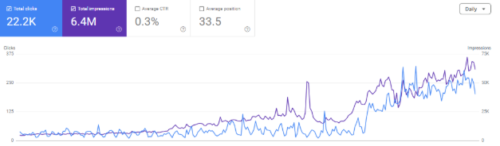
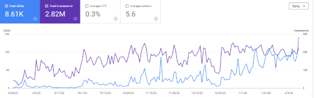
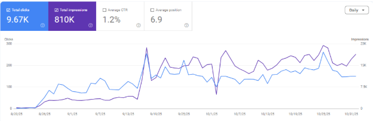
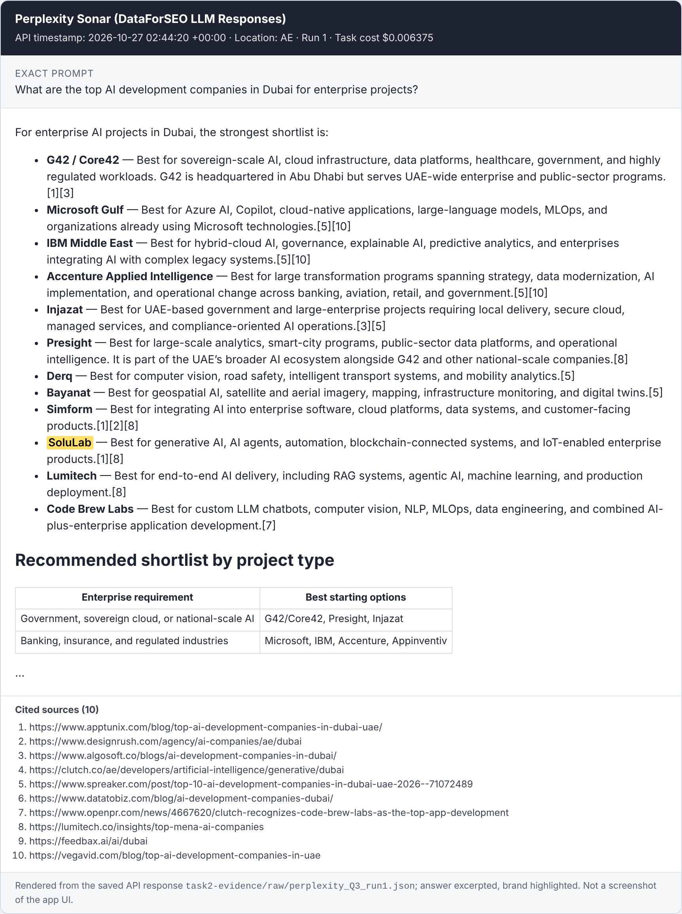
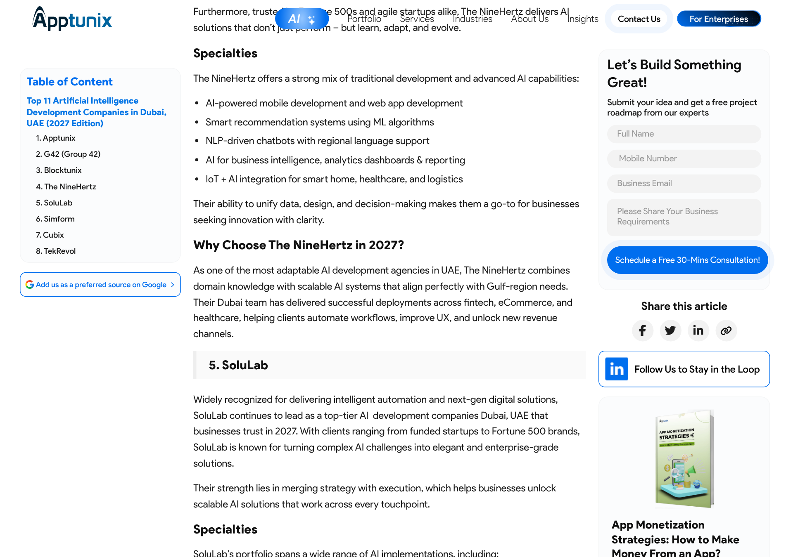
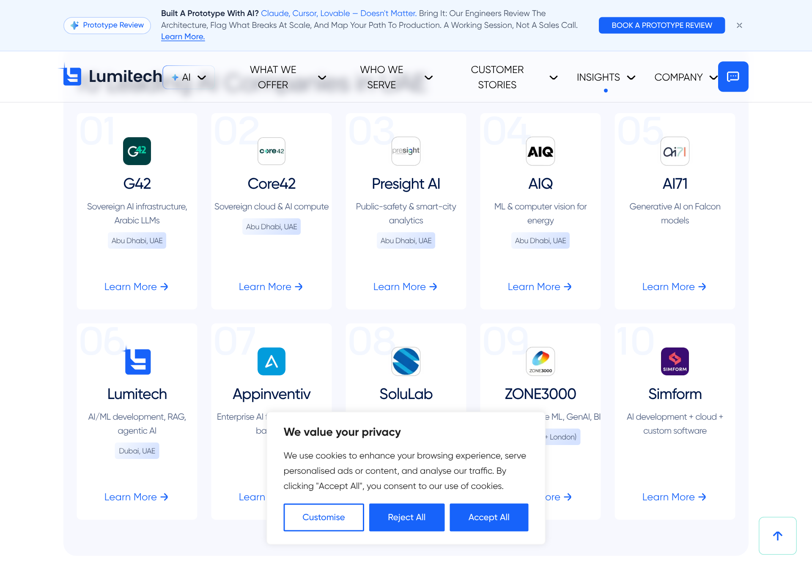
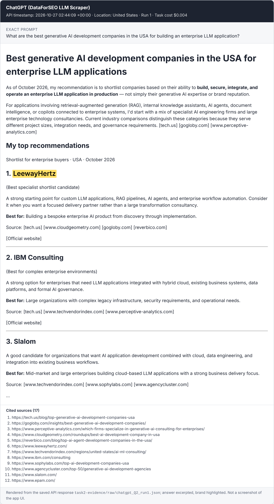

# Practical Assignment: LLM Visibility & Growth Consultant (SoluLab)

## Task 1: A previous success: Algoscale Technologies (Data & AI consulting)

| | |
|---|---|
| **Company** | Algoscale Technologies, a data and AI consulting firm. It competes in a category dominated by Accenture, TCS and Deloitte, which is the same position SoluLab is in. |
| **My role** | Growth Marketing Manager, Dec 2024–present. I built the SEO function from zero and ran the AEO/GEO programme. |
| **Constraint** | No paid search at any point. Pipeline came from organic and PR only. |
| **Platforms** | Google AI Overviews, ChatGPT, Perplexity, Gemini. |
| **Scope** | 200+ target queries across Algoscale's data and AI consulting services. |

**Three commercial queries:** [[add the three queries]]

**The three interventions that mattered most:**
1. **Service and proof pages.** I built 100+ service pages and 25 case studies, rebuilt the full website, and ran a topical-authority programme designed to compete with enterprise incumbents.
2. **Third-party presence through PR.** Outreach placed Algoscale alongside Accenture, TCS and Deloitte in authoritative publications.
3. **Systematic community distribution.** A presence across Reddit, Quora, LinkedIn and niche data and AI communities, run as its own channel for referral traffic, brand signals and organic link equity.

**AI visibility results:**
- 50+ placements in Google AI Overviews.
- Consistent citations in ChatGPT, Perplexity and Gemini, alongside Accenture, TCS and Deloitte.

**One failed experiment and the lesson:** [[add one]]

**Commercial outcome:**

| Metric | Result |
|---|---|
| Monthly sessions | 0 → 65K in 12 months |
| Pipeline | $1M+ built in 6 months |
| Revenue realised | $450K, purely organic |
| AI referrals | More than 10% of monthly pipeline |
| US and Western leads | +25% month on month, through organic and PR alone |
| Search Console | 22.2K clicks, 6.4M impressions |
| Most transactional blog | 8.61K clicks, 2.82M impressions, average position 5.6 |
| Top service page | 9.67K clicks, 810K impressions, 1.2% CTR |

*Algoscale Search Console, site total.*

*Most transactional blog: 8.61K clicks, 2.82M impressions, position 5.6.*

*Top service page: 9.67K clicks, 810K impressions, 1.2% CTR.*

**The same method in other roles:**
- **Insighto.ai (B2B AI SaaS, Dec 2024–present):** semantic content architecture and AI-assisted topical coverage as the core of a product-led funnel. 0 → 30K sessions in 6 months, $100K ARR, 50–60 MQLs a month, and 186K impressions on the transactional blog.
- **Taggbox / Tagshop (B2B SaaS, May 2023–Dec 2024):** Reddit, Quora and forum programmes as a dedicated distribution layer across four products. Monthly sessions 16K → 60K (+275%). A Tagshop domain migration with zero traffic loss (2K → 13K sessions). 50+ qualified enterprise MQLs a month and a $100K ARR enterprise content pipeline.

---

## Task 2: SoluLab's current visibility audit

### Method

| | |
|---|---|
| **Test date** | **October 27, 2026, 02:42–02:45 UTC.** 45 runs, all timestamped by the API. |
| **Platforms (3)** | **ChatGPT**: the consumer ChatGPT answer with web search, collected through DataForSEO's LLM Scraper. **Google AI Mode**: DataForSEO SERP API. **Perplexity**: the Sonar model with web search, through DataForSEO's LLM Responses API. |
| **Location** | US prompts with a US location (2840). Q3 with a UAE location (2784). Q4 with a Saudi Arabia location (2682). English throughout. |
| **Runs** | **3 independent runs per prompt per platform.** All results are reported as rates ("2/3"), not as one answer treated as a ranking. |
| **What's logged** | Exact prompt, full answer, every cited URL, SoluLab mentioned / recommended / cited, the companies named, and any solulab.com URL that was retrieved but not cited. |
| **Evidence** | `task2-evidence/raw/*.json` (45 full API responses), `task2-evidence/runs.csv` (one row per run), `task2-evidence/summary.md`, and `task2-evidence/cited-sources-check.tsv` (whether the top 45 cited pages name SoluLab or LeewayHertz). Script: `run_dataforseo_task2.py`, rerunnable with `--runs 3`. |
| **Cost** | $0.215 in total. |

**Definitions:**
- **Mentioned:** "SoluLab" appears in the answer.
- **Recommended:** SoluLab is one of the shortlisted companies, with a reason.
- **Cited:** a solulab.com URL appears among the answer's sources.

### Results

| ID (market) | Platform | Mentioned | Recommended | Cited | Companies named (runs out of 3) | Third-party URLs cited most (runs out of 3) |
|---|---|---|---|---|---|---|
| **Q1** AI agents (US) | ChatGPT | 0/3 | 0/3 | 0/3 | Accenture, IBM Consulting, EPAM (3); Cognizant, Deloitte, Slalom, AWS, Microsoft (2) | ibm.com, epam.com, accenture.com (3); powergatesoftware.com list, ayautomate.com list (2) |
| | Perplexity | 0/3 | 0/3 | 0/3 | Accenture, IBM Consulting, Microsoft, Cognizant, **LeewayHertz**, Avenga, Intellectyx, Qubika, Spiral Scout (3) | christianandtimbers.com, anadea.info, hudasoft.com, nerdheadz.com, esparkinfo.com lists (3) |
| | AI Mode | 0/3 | 0/3 | 0/3 | Accenture, AWS (3); Deloitte, Google Cloud, Salesforce (2) | pixelmatters.com list (3); outsystems.com, airtable.com (2) |
| **Q2** Gen AI (US) | ChatGPT | 0/3 | 0/3 | 0/3 | **LeewayHertz**, EPAM, Booz Allen Hamilton, Slalom, IBM Consulting, HatchWorks AI (3) | tech.us list, agencycluster.com Top-50 (3); epam.com, slalom.com, boozallen.com (3) |
| | Perplexity | 0/3 | 0/3 | 0/3 | **LeewayHertz**, Thoughtworks, Databricks, HatchWorks AI, Accenture (3); 10Pearls, Xavor, BCG X (2) | classicinformatics.com, tech.us, pixelbrainy.com, sapidblue.com, azilen.com lists (3) |
| | AI Mode | 0/3 | 0/3 | 0/3 | **LeewayHertz**, Cohere (3); IBM, Accenture, Databricks (2) | reddit.com r/AI_Agents thread, pixelmatters.com list (2); tech.us (1) |
| **Q3** AI dev (Dubai) | ChatGPT | 0/3 | 0/3 | 0/3 | Presight, Gulf Business Machines (3); Core42, e& enterprise, Alpha Data, Hidden Brains (2) | presight.ai, gbmme.com, emtech.ae list (3); quytech.com list (2) |
| | Perplexity | **3/3** | **3/3** | 0/3 | **SoluLab** (listed 7th–10th of 10–12), Presight, Derq, Microsoft Gulf, IBM Middle East, Simform, Injazat, Code Brew Labs (3) | **lumitech.co MENA list (SoluLab #8)**, **apptunix.com Dubai list (SoluLab #5)**, designrush.com Dubai, clutch.co UAE Gen-AI, datatobiz.com (3) |
| | AI Mode | 0/3 | 0/3 | 0/3 | G42/Core42, Code Brew Labs, Apptunix, TechGropse (1 each: volatile) | masterofcode.com Dubai list (3) |
| **Q4** AI consulting (KSA) | ChatGPT | 0/3 | 0/3 | 0/3 | Accenture, Bilytica, Pulse Innovation (3); Capgemini, SCAI, Crux (2) | picsaudi.com, bilytica.com (3); apexaiarabia.com, scai.sa (2) |
| | Perplexity | 0/3 | 0/3 | 0/3 | McKinsey/QuantumBlack, BCG X, Opinosis Analytics, MHK Services, Saudi Digital Consulting, Digital Transformation KSA (3) | saudidigitalconsulting.com, aisuperior.com (EN and **Arabic** pages), labarna.ai list, crux.sa, clutch.co Saudi Gen-AI (3) |
| | AI Mode | 0/3 | 0/3 | 0/3 | Tharwah (2); BCG, Oliver Wyman, Strategy&, Mozn, Elm, Lucidya (1) | ozonetech.com.sa, LinkedIn "Top 20 AI consulting firms in Saudi Arabia", tharwah.net (2) |
| **Q5** AI agent cost (US) | ChatGPT | 0/3 | 0/3 | 0/3 | Accenture, Expedey, QueryNow (2–3); **LeewayHertz**, EPAM (1) | ryzlabs.com list, expedey.com (3); fusionhit.com cost guide (2) |
| | Perplexity | 0/3 | 0/3 | 0/3 | Moveworks (3); **LeewayHertz**, Infosys, Accenture, Deloitte Digital, Booz Allen, Wizeline (2) | vantasoft.com cost guide and list, scalacode.com list (SoluLab #6), factoryjet.com list (3) |
| | AI Mode | 0/3 | 0/3 | 0/3 | LeewayHertz, C3 AI (1); mostly vendor categories, not firms | productcrafters.io cost guide, pixelmatters.com list (3); reddit.com cost thread (2) |

**Headline:**
- SoluLab was **mentioned in 3 of 45 runs (7%)**, all on Perplexity for Dubai, where it was recommended every time.
- **solulab.com was cited in 0 of 45 runs.**
- One solulab.com page was retrieved but not cited: ChatGPT's search results for Q2 included `/generative-ai-consulting-company/`. That's the *consulting* page, not the development page that matches the query.

### What the evidence shows

1. **Recommendations follow third-party sources, not SoluLab's own site.** [Verified]
   - The only time SoluLab is recommended, Perplexity's footnotes point to two third-party lists that include SoluLab: Lumitech's MENA list (#8, "GenAI, agents, blockchain & IoT") and Apptunix's Dubai list (#5, dated Oct 23, 2026).
   - Perplexity's description of SoluLab ("generative AI, AI agents, automation, blockchain… IoT") closely mirrors Lumitech's wording.
   - No solulab.com page was cited anywhere.
2. **Being on a list isn't enough. Consensus and position matter.** [Verified sources; Inferred mechanism]
   - In the US AI-agent cluster, SoluLab *is* on 4 of the cited lists (Hudasoft #7, ScalaCode #6, Classic Informatics #7, DBB Software #15). It still wasn't named.
   - LeewayHertz, its closest peer, sits higher on 3 of those 4 lists (#4, #4 and #4; Classic Informatics has SoluLab #7 ahead of LeewayHertz #8). It's also on about 9 more cited lists where SoluLab is absent: pixelmatters, tech.us, agencycluster, christianandtimbers, nerdheadz, inoxoft, signity, sapidblue, and a Space-O LinkedIn list.
   - LeewayHertz was named on **all three platforms** for Q2.
   - In Dubai it's reversed: SoluLab is on 2 of Perplexity's 10 sources, LeewayHertz on none, and only SoluLab gets named.
3. **Each platform draws on different sources, and two of them vary a lot from run to run.** [Verified]
   - The average overlap of cited domains between runs was **1.00 on Perplexity** (identical sources every run) but **0.34 on ChatGPT and 0.31 on AI Mode**.
   - So a win on Perplexity's Dubai sources doesn't carry over to ChatGPT, which cites presight.ai, gbmme.com, emtech.ae and quytech, or to AI Mode, which cites masterofcode.com.
   - ChatGPT and AI Mode need more runs and repeat days before any change can be called real.
4. **GCC answers favour local sources.** [Verified]
   - KSA answers cite Saudi consultancies, Clutch's Saudi category, and an Arabic-language page (aisuperior.com/ar/…).
   - SoluLab has no KSA third-party footprint in any cited source, and the Big Four and MBB firms dominate.

### Evidence images

*Q3, Perplexity Sonar, Oct 27, 2026 02:44 UTC, UAE. SoluLab is on the shortlist. Its citations [1] and [8] are the Apptunix and Lumitech lists below. Rendered from `task2-evidence/raw/perplexity_Q3_run1.json`; this is not an app screenshot.*

*Source [1]: apptunix.com "Top 11 AI development companies in Dubai, UAE". SoluLab is #5. Browser screenshot, Oct 27, 2026.*

*Source [8]: lumitech.co "Top MENA AI companies". SoluLab is #08. Browser screenshot, Oct 27, 2026. The site's cookie banner covers part of the row.*

*Q2, ChatGPT, Oct 27, 2026 02:44 UTC, US. LeewayHertz is ranked #1 with third-party lists as its sources. SoluLab doesn't appear. Rendered from `task2-evidence/raw/chatgpt_Q2_run1.json`.*

### One opportunity per query

| ID | Opportunity | Evidence |
|---|---|---|
| Q1 | **Get onto the US AI-agent lists that cite LeewayHertz but not SoluLab, and move up on the ones it's already on.** Targets: pixelmatters.com (cited in 3/3 AI Mode and 2/3 ChatGPT runs for Q1, and in 3/3 AI Mode runs for Q5), christianandtimbers.com, nerdheadz.com, inoxoft.com and signitysolutions.com. Pitch Hudasoft, ScalaCode and DBB for an update with a fresh agent case study. | `cited-sources-check.tsv`. SoluLab sits #6–#15 on 4 cited lists and is absent from the most-cited one. |
| Q2 | **Get into tech.us and agencycluster.com.** tech.us was cited on all three platforms (7 of 9 runs). Make `/generative-ai-development-company/` the page engines retrieve. | LeewayHertz is named 9/9 for Q2. ChatGPT retrieved SoluLab's *consulting* page instead. The development page is 3.3 MB of HTML. |
| Q3 | **Copy the Perplexity win onto ChatGPT and AI Mode sources.** Pitch masterofcode.com's Dubai list (3/3 AI Mode), emtech.ae and quytech.com (ChatGPT), and complete the Clutch UAE and DesignRush Dubai profiles (both cited 3/3 on Perplexity). | Recommended 3/3 on Perplexity via Lumitech and Apptunix. 0/6 on the other two platforms, which use different sources. |
| Q4 | **Build a KSA footprint before expecting mentions:** a Clutch Saudi Gen-AI listing (cited 3/3), labarna.ai list outreach, and an Arabic version of the KSA page, since an Arabic page was cited for an English prompt. | 0/9 runs. No cited KSA source names SoluLab. |
| Q5 | **Run E2:** one answer-first AI-agent cost hub with SoluLab's real price bands, plus inclusion on ryzlabs.com and factoryjet.com. | Cost answers cite vendor cost guides (vantasoft, productcrafters, fusionhit). SoluLab's cost page was neither retrieved nor cited. ScalaCode already lists SoluLab #6. |

**Cross-cutting issue: entity consistency.**
- The site gives conflicting company facts: 1,500+ vs 500+ vs 150+ projects delivered, and 11+ vs 10+ years.
- It says "US-based" while the Organization schema gives Ahmedabad as the main address.
- Directories list headcount anywhere from 50 to 250+.

Engines blend these sources, so the conflict weakens every recommendation.

**Limitations:**
- These are API runs from one day.
- The ChatGPT answers come from DataForSEO's logged-out consumer scraper. Perplexity was tested through its Sonar API, not the consumer app.
- Screenshots of the same prompts from a normal browser session, plus a second test day, are the next step before treating any rate as stable.

---

## Task 3: The three experiments I'd run first

The order is by expected effect on **commercial** prompts per hour of effort. E1 is the distribution experiment the assignment asks for.

### E1. Get onto the third-party sources the engines already cite (distribution)

| | |
|---|---|
| **Hypothesis** | For "best / top X companies" prompts, ChatGPT and Perplexity build the answer from a small set of retrieved third-party pages: directories, editorial listicles, analyst roundups. If SoluLab is present and well described on the sources already cited for its cluster, its mention rate on those prompts goes up. |
| **Target cluster** | Vendor selection, US and GCC: Q1, Q3 and Q4, plus 6 variants (e.g. "AI agent development company USA", "best AI development company UAE", "AI consulting firm Riyadh"). 9 prompts in total. |
| **Exact action** | 1. Take every third-party URL cited in the Task 2 baseline for these prompts. Rank them by how many runs cited them. 2. Sort each into a type: **Directory** (Clutch, GoodFirms, DesignRush, TechBehemoths), **Editorial list**, **Analyst or media**, **Forum / Q&A**, or **Competitor self-list** (skip these). 3. For the top 15 by frequency: **Directories**: complete SoluLab's AI and Gen-AI service focus, add UAE and KSA service areas and portfolio items, and get 5 new verified reviews from AI and agent clients (Clutch first; it's already in SoluLab's `sameAs`). **Editorial lists**: pitch the author for inclusion or an update, using an evidence pack (2 AI case studies with metrics, Clutch rating, one named expert, and a two-line differentiator). **Media**: one bylined expert article in a US publication and one in a GCC publication. **Forums**: genuine, disclosed answers from named engineers. No link drops. |
| **Why I expect it to work** | **Task 2 shows the mechanism directly.** (a) SoluLab's only recommendation (Perplexity, Dubai, 3/3) traces to two third-party lists that include it, Lumitech (#8) and Apptunix (#5). Perplexity even reuses Lumitech's description of SoluLab. (b) LeewayHertz is on 10 of the 15 most-cited US lists and is named on all three platforms for Gen AI. SoluLab is on 3 of 15, low down, and is never named. (c) solulab.com was cited in 0 of 45 runs, so the site alone isn't what gets SoluLab into answers. (d) SoluLab's 92 self-ranking "Top 10" posts were never cited. |
| **Baseline** (Task 2, Oct 27, 2026) | **Mention rate: 3/36 runs (8%)** on Q1–Q4 × 3 platforms × 3 runs, all on Perplexity Dubai. **Presence on the 15 most-cited lists and directories: SoluLab 3/15** (Hudasoft, DBB Software, Classic Informatics; DesignRush unverified) **vs LeewayHertz 10/15.** The 6 cluster variants get baselined in the same run before launch. |
| **Success metric** | **Leading:** SoluLab present on ≥8 of the top-15 sources by week 6, up from 3. **Primary:** mention rate up ≥15 percentage points over baseline at both week 6 and week 8 (two re-measures, to rule out noise). **Commercial:** ≥2 inquiries that self-report an AI assistant or arrive from an AI-referrer, by week 10. |
| **Evaluation period** | 8 weeks (6 for execution, plus 2 re-measures). |
| **Effort / owner** | About 30 hours over 6 weeks. Owner: marketing executive, following the SOP in Task 4. I review weekly. Delivery or sales supplies the client reference requests for reviews. |
| **If it fails** | If inclusions land but mention rate doesn't move, re-check which sources are now cited (the engines may have switched sets), weight effort toward directories with review velocity, and run E3 first. If inclusions don't land, change the offer from "please add us" to something the author wants (original data, an expert quote, a correction to their list) and re-pitch. |

### E2. Answer-first, evidence-dense rewrite of the AI agent cost cluster (on-site content)

| | |
|---|---|
| **Hypothesis** | Cost prompts make engines cite pages that state a concrete price range with a scope and timeline breakdown. Rewriting SoluLab's AI-agent cost content answer-first, with real price bands and sourced statistics, will raise the citation rate of solulab.com on cost prompts. |
| **Target cluster** | Q5 plus: "AI agent development cost", "cost to build an AI customer service agent", "monthly cost of running an AI agent", "AI agent MVP cost". 5 prompts. |
| **Exact action** | 1. Make `/how-much-does-it-cost-to-build-an-ai-agent/` the hub. Keep `/autonomous-ai-agent-cost-per-month/` (run cost) and `/ai-agent-mvp-cost-for-small-businesses/` (MVP) as spokes with distinct intent. Merge any true duplicate and 301 it. 2. Open with a 50-word answer that states SoluLab's actual range. 3. Add a scope × cost × timeline table built from **real SoluLab quotes from the last 12 months** (sales provides these). 4. Add a "From our projects" box with 3 anonymized engagements. 5. Add 3–5 statistics, each linked to its primary source. 6. Show the "Updated" date. 7. Add the same table to `/ai-agent-development-company/`. 8. Submit through IndexNow and Bing Webmaster Tools, and request indexing in GSC. **Control:** leave the LLM-development-cost post untouched. |
| **Why I expect it to work** | (a) Research on generative-engine optimization (Aggarwal et al., *GEO: Generative Engine Optimization*, KDD 2024, arXiv:2311.09735) found that adding statistics, citations and quotations raised a source's visibility in generative answers, by up to roughly 40% in their benchmark. (b) The audit shows SoluLab's openings are hooks ("the honest answer is: it depends"). Posts have a median of 0–1 sourced statistics and no visible updated date, so there's a clear gap to close. (c) Cost answers need numbers, and vendor pages are a natural source for them. |
| **Baseline** | **Q5: solulab.com cited 0/9 runs and mentioned 0/9** (Task 2). SoluLab's cost page wasn't even retrieved. Cost answers cite vantasoft.com, productcrafters.io and fusionhit.com cost guides. The 4 other cost prompts and the control get baselined before publishing. GSC impressions and CTR for the hub and the control over the last 28 days come from SoluLab's GSC. |
| **Success metric** | solulab.com cited in ≥25% of runs, or +15 points over baseline, in weeks 4–6, while the control doesn't move. GSC CTR on the hub is not down. |
| **Evaluation period** | 6 weeks after publishing (re-measure at weeks 2, 4 and 6). |
| **Effort / owner** | About 14 hours: writer 10 h, sales input 2 h, dev 1 h, my review 1 h. Owner: content lead. |
| **If it fails** | First check the page is re-crawled and indexed in Bing and Google with the new content. If it's indexed but not cited, the engines are getting cost data elsewhere. Look at which URLs they cite, then distribute the same table through a named-expert LinkedIn article and a submission to a cited third-party cost guide, which is E1-style. |

### E3. One set of company facts everywhere (entity consistency)

| | |
|---|---|
| **Hypothesis** | Buyers vet vendors by asking AI ("Is SoluLab legit?", "Where is SoluLab based?"). Aligning SoluLab's facts across its site, schema and top external profiles will raise the accuracy and confidence of those answers. That protects deals that are already in the pipeline, which is the fastest route to the Q1 closure target. |
| **Target cluster** | Brand and vetting prompts: "What is SoluLab?", "Is SoluLab a good company to work with?", "SoluLab reviews", "Where is SoluLab based and how big is it?", "SoluLab vs LeewayHertz". |
| **Exact action** | 1. Write a one-page fact sheet: legal entities, HQ and offices, founding year, headcount band, projects delivered (one defined number), certifications with IDs, and core services. 2. Fix the conflicting numbers on the site: replace the per-template stats strips with one shared component, and resolve "US-based" vs the schema address. 3. Update the About page, the Organization schema (address, `location`, `numberOfEmployees`, a complete `sameAs`) and `llms.txt`. 4. Update the external profiles to match, and ask Clutch, IoT ONE and Celent to merge duplicate listings: Clutch, GoodFirms, DesignRush, Built In, IoT ONE, Celent, Crunchbase, LinkedIn. 5. Publish a Reviews page that links out to Clutch. |
| **Why I expect it to work** | The facts are verifiably inconsistent today (Task 2, cross-cutting issue). Search-enabled answers retrieve these pages directly, and every fix here is fully under SoluLab's control. |
| **Baseline** | Fact-accuracy score: 5 prompts × 2 platforms × 3 runs, each answer scored on 5 facts (HQ, size, founding year, core services, rating). Not yet measured: run the 5 brand prompts through `run_dataforseo_task2.py` (about $0.20) before launch. |
| **Success metric** | Fact accuracy ≥80% and 0 contradictions in search-on answers by week 8. Model-memory answers lag, so they're tracked separately. |
| **Evaluation period** | 8 weeks. |
| **Effort / owner** | About 12 hours of marketing time plus 2 hours of dev. Owner: marketing executive. |
| **If it fails** | Look at the URLs cited in the wrong answers and fix those specific sources. If wrong facts come from model memory, not retrieval, accept the lag and keep re-measuring quarterly. |

---

## Task 4: SOP for E1, getting onto cited third-party sources

**Purpose:** get SoluLab included, accurately, on the third-party pages AI engines cite for the vendor-selection prompts we care about, and measure the effect.
**Owner:** marketing executive. **Reviewer:** LLM visibility lead. **Cadence:** a 2-week cycle, repeated.

**Inputs:**
- The prompt panel (`task2-prompts.csv` plus the cluster variants)
- The results log
- The evidence pack: 2 AI case studies with metrics, Clutch link and rating, an expert bio, a 2-line differentiator, and approved logos
- The canonical fact sheet (E3)

**Tools:** ChatGPT, Perplexity (plus the Claude script), Google Sheets, the Clutch / GoodFirms / DesignRush dashboards, an email-finder, HubSpot.

**Deliverables:** a source tracker sheet, outreach log, updated profiles, and a fortnightly one-page report.

**Steps:**
1. **Measure.** Run each prompt 3 times per platform in fresh sessions, following the protocol in Task 2. Save screenshots as `Q#_platform_run#_YYYYMMDD.png`. Log every cited URL.
2. **Build the source list.** In the tracker, list each cited third-party URL with columns: domain, type (Directory / Editorial / Media / Forum / Competitor self-list), how many runs cited it, whether SoluLab is present (Y/N), and whether the description is accurate (Y/N). Drop competitor self-lists.
3. **Prioritize.** Score each source as *times cited × feasibility*. Feasibility: directory = 3, editorial with a contact = 2, media = 1. Work the top 15.
4. **Directories (week 1).** Bring each profile in line with the fact sheet. Add the AI, Gen-AI and AI-agent focus, UAE and KSA service areas, and 3 AI portfolio items. Ask 5 recent AI clients for verified reviews, using the template in the evidence pack. Sales picks the clients.
5. **Editorial and media (weeks 1–2).** Find the author. Send a short pitch: why the list's readers would benefit, one specific fact or data point, and the evidence pack. Offer an expert quote or original data rather than a plain "add us" request. Follow up once after 5 working days.
6. **Forums (ongoing).** A named engineer answers relevant open questions with real detail and discloses the affiliation. Never post from anonymous or brand-new accounts.
7. **Log everything** in the outreach log: date, contact, ask, response, and the live URL once included.
8. **Re-measure** in week 6 and week 8 with the same prompts, platforms and run count. Update the tracker.

**Quality-control checklist** (the reviewer signs off before anything goes out):
- [ ] Every fact matches the fact sheet. No unapproved client names or numbers.
- [ ] No paid or "sponsored" placements presented as editorial. Any paid listing is disclosed and tagged in the tracker.
- [ ] No posting on platforms where SoluLab would be ranking itself (e.g. user-generated "Top 10" posts on third-party forums).
- [ ] Review requests follow the platform's rules: no incentives, no gating.
- [ ] Screenshots and run logs saved for every measurement round.
- [ ] The outreach is personalized: it names the list and why SoluLab fits its readers.

**Measurement and reporting** (fortnightly, one page):
- Sources: present now vs baseline (n/15).
- Mention rate by platform and prompt (rates, not single answers), with the change since baseline.
- New cited sources that appeared, and sources that dropped out.
- GA4 "AI referrals" channel sessions and conversions, plus HubSpot inquiries where "How did you hear about us?" = AI assistant.
- Actions planned for the next cycle.

**Repeat, improve or stop:**
- **Repeat and scale** to the next cluster (Gen-AI US, RWA, stablecoin) if presence is ≥6/15 *and* mention rate is up ≥15 points at two consecutive re-measures.
- **Improve** if presence is up but mention rate is flat: re-check cited sources, shift effort to the sources cited most, and run E3.
- **Stop or redesign** if fewer than 3 of 15 inclusions land after 2 cycles (the offer isn't working), or if a platform or editorial policy issue comes up.

### From visibility to the $30k Q1 and $250k annual closure targets

**Attribution setup** (week 1, using tools SoluLab already runs; the site loads HubSpot and the HandL UTM Grabber):
- A GA4 channel group for AI referrers (chatgpt.com, perplexity.ai, gemini.google.com, copilot.microsoft.com, claude.ai).
- HandL's first-touch referrer and landing page passed into HubSpot hidden fields.
- A required "How did you hear about us?" field with an "AI assistant (ChatGPT, Perplexity…)" option. Many AI-influenced buyers never click, so this is the only way to see them.
- Sales asks the same question on discovery calls and tags deals "AI-influenced".

**Commercial math.** These are planning assumptions, to be replaced with SoluLab's own CRM rates.
- Clutch shows SoluLab's most common project size at $50k–$199k. So $250k a year is roughly **3–5 closed deals**, and $30k in Q1 is about **one discovery, MVP or first-phase deal**.
- At a 20–25% SQL-to-close rate, that needs about **15–20 AI-influenced SQLs a year** (4–5 a quarter).
- At about 30% inquiry-to-SQL, that's about **50–65 qualified inquiries a year**.

**Q1 sequencing.** B2B cycles of 60–120 days mean Q1 revenue must come from buyers already in motion. So in the first 6 weeks I'd prioritize:
1. **E3**, because accurate answers to "Is SoluLab legit?" help close deals already in the pipeline.
2. **E1 on vendor-selection prompts**, because those buyers are shortlisting now.
3. **E2 on cost prompts**, because those buyers are budgeting.

Reported weekly to the team:
- Prompt-panel mention and citation rates
- AI-referral sessions
- AI-influenced inquiries and SQLs
- Pipeline value
- Closed revenue against the $30k / $250k targets

That way visibility work is judged on pipeline, not on screenshots.

---

*Prepared with AI assistance for crawling and analysis of solulab.com. All site figures come from my crawl on Oct 26, 2026 (method and data in the linked audit). AI-platform results come only from the dated runs logged in Task 2.*
